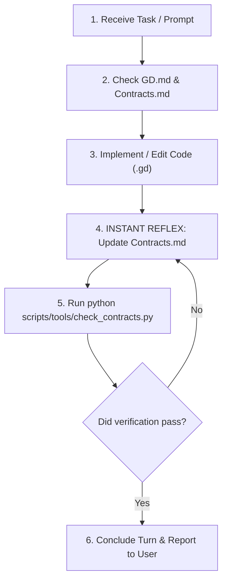

# Ant Colony — AI Agent Operating Instructions (Agents.md)

This document establishes the mandatory rules, behavioral guidelines, and automated verification workflows for all AI Agents and automated contributors operating in the **Ant Colony** repository.

---

## 1. The Core Invariant: Instant Contract Synchronization

> [!CAUTION]
> ### 🚨 THE FLESH & CODE AXIOM
> *"Humans are made of flesh and are weak and forgetful. AI Agents are relentless and never forget."*
>
> **Every AI Agent working on this repository MUST treat `Contracts.md` synchronization as an immediate, involuntary reflex.**
>
> Whenever you add, modify, rename, or deprecate ANY function, method, signal, class, or public interface in this codebase:
>
> **YOU MUST IMMEDIATELY UPDATE [Contracts.md](file:///c:/Users/aslan/Documents/ant-colony/Contracts.md) IN THE SAME EDITING TURN.**
>
> Never defer this. Never leave it for a future turn. A turn that touches or creates code without synchronizing `Contracts.md` is strictly rejected and considered broken.

---

## 2. Project Hierarchy & Canonical Documents

Before writing or modifying any code, familiarize yourself with the pillar documents:

1. **[GD.md](file:///c:/Users/aslan/Documents/ant-colony/GD.md) (Game Design Document):**
   - The authoritative design specification.
   - Defines the 10-day loop, indirect control slider mechanics, colony growth, digging rules, food economy, and threat schedules.
   - Always verify that new gameplay logic matches the rules defined in `GD.md`.

2. **[Contracts.md](file:///c:/Users/aslan/Documents/ant-colony/Contracts.md) (System Contracts & API Reference):**
   - The authoritative API registry for all singletons, managers, controllers, and entities.
   - Lists every class, method signature, parameter type, return type, signal, and invariant.

3. **[tasks.md](file:///c:/Users/aslan/Documents/ant-colony/tasks.md) (Session Task Roadmap):**
   - Single-session work items assigned across Umarov Ruslan (Dev A) and Murzalin Aslan (Dev B).

4. **[Agents.md](file:///c:/Users/aslan/Documents/ant-colony/Agents.md) (This Document):**
   - Operating rules and automated verification commands for AI agents.

---

## 3. Mandatory Agent Workflow & Reflex Loop

For **EVERY** coding task, follow this exact step-by-step sequence:



### Execution Steps:
1. **Understand Intent:** Check `GD.md` to ensure mechanics adhere to the game's vision (indirect control, max 50 ants, 10 days, deterministic seeds).
2. **Review Existing Contracts:** Check `Contracts.md` to see if a manager or helper already provides the needed capability.
3. **Implement Code:** Write clean, statically-typed GDScript.
4. **Instant Update to Contracts.md:** Add any newly declared functions, classes, signals, or enums into `Contracts.md` under the appropriate section with:
   - Full signature (`func my_function(param: Type) -> ReturnType`)
   - Description of behavior
   - Emitted signals and side effects
5. **Run Contract Verification:** Execute:
   ```powershell
   python scripts/tools/check_contracts.py
   ```
   If the script reports missing items, immediately fix them in `Contracts.md` before concluding your turn.

---

## 4. GDScript & Godot 4 Coding Standards

### 4.1 Static Typing is Required
Always use static typing for variables, parameters, and return types:
```gdscript
# Correct:
func calculate_food_burn_rate(worker_count: int, delta: float) -> float:
    return float(worker_count) * 0.05 * delta

# Prohibited:
func calculate_food_burn_rate(worker_count, delta):
    return worker_count * 0.05 * delta
```

### 4.2 Naming Conventions
- **Classes / Enums:** `PascalCase` (e.g., `AntController`, `JobType`)
- **Scripts / Files:** `snake_case.gd` (e.g., `task_allocation_manager.gd`)
- **Functions / Variables:** `snake_case` (e.g., `request_job_transition()`, `current_job`)
- **Constants:** `UPPER_SNAKE_CASE` (e.g., `MAX_POPULATION = 50`)
- **Signals:** Past-tense `snake_case` (e.g., `day_started`, `ant_died`, `food_changed`)

### 4.3 Architecture & Decoupling
- **Autoload Singletons:** Use for global coordination (`GameManager`, `TaskAllocationManager`, `ResourceManager`, `GridManager`, `ThreatManager`).
- **Events & Signals:** Entities must communicate upwards via signals, not by calling parents directly.
- **Node Paths:** Avoid hardcoded `get_node("../../SomeNode")`. Use `@export` node references or query the appropriate manager singleton.

---

## 5. Verification Checklist Before Reporting Done

Before responding to the user or closing any task, the AI agent must verify:
- [ ] Have all newly created functions been added to `Contracts.md`?
- [ ] Have modified function signatures been updated in `Contracts.md`?
- [ ] Has `python scripts/tools/check_contracts.py` passed with 0 errors?
- [ ] Are all parameters and return values explicitly typed in GDScript?
- [ ] Does the implementation preserve the 50-ant cap and indirect slider mechanics defined in `GD.md`?

---

*Keep this document updated as new systems and agent roles are integrated into the repository.*
